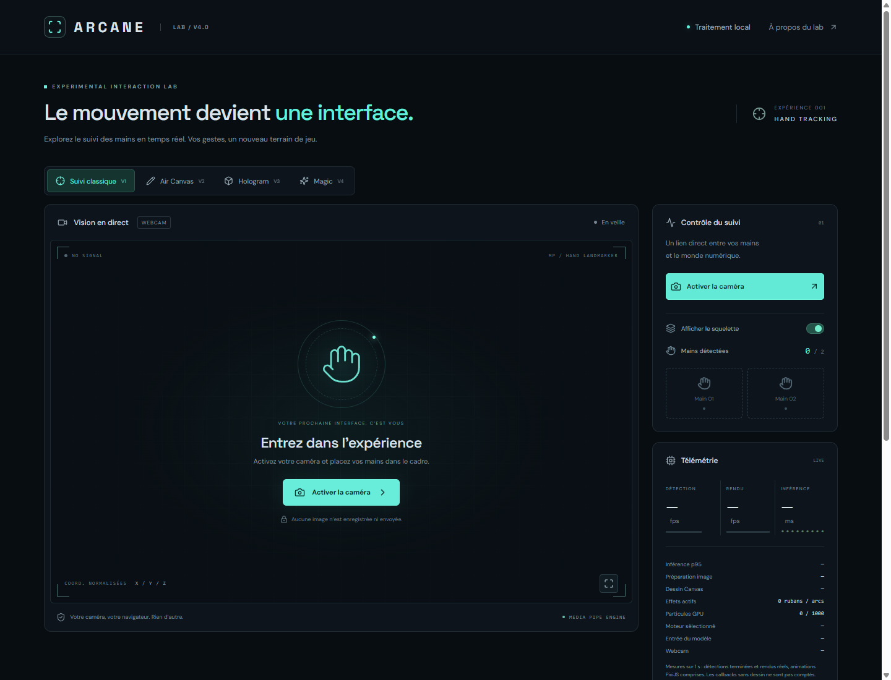
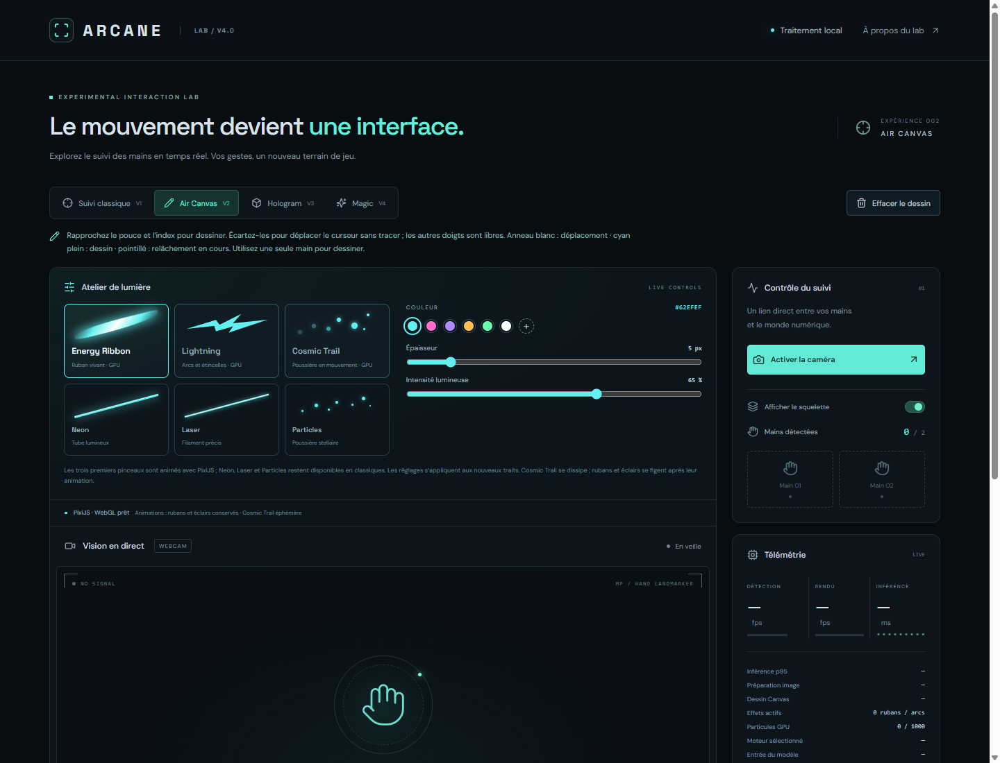
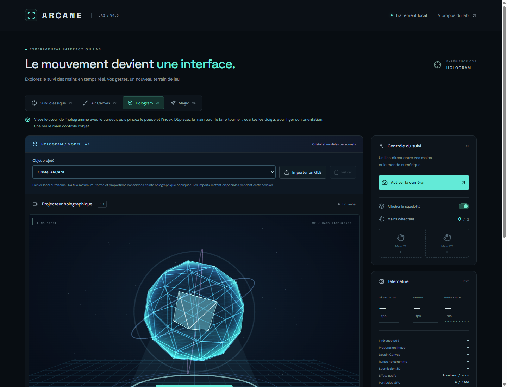
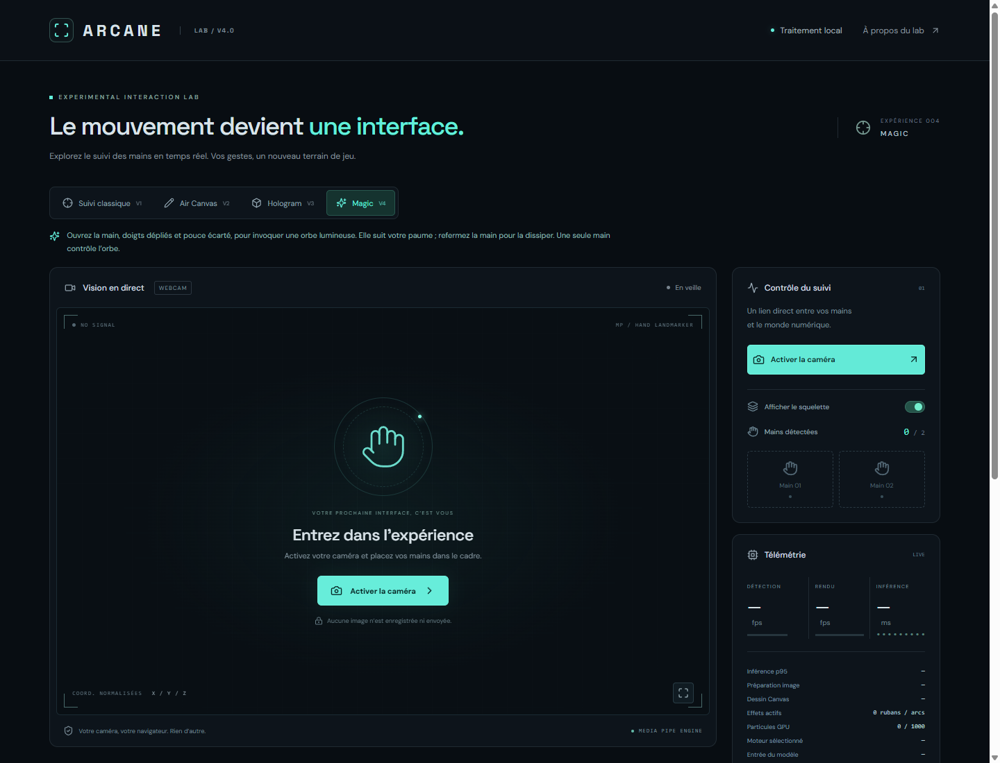

# ARCANE

**Le mouvement devient une interface.**

Un laboratoire d’interaction gestuelle dans le navigateur : dessiner dans l’air, manipuler un hologramme et invoquer une orbe lumineuse avec une simple webcam. ARCANE réunit vision par ordinateur et rendu graphique temps réel dans une interface sombre aux accents cyan.



> Projet en préparation de publication. Les liens GitHub et démo seront ajoutés après autorisation et vérification du déploiement. [Portfolio de Sylvain Goncalves](https://portfolio.fictyverse.com/).

## Quatre façons d’explorer le geste

| Module            | Interaction                                                 | Rendu                                                                |
| ----------------- | ----------------------------------------------------------- | -------------------------------------------------------------------- |
| **Hand Tracking** | Détection de deux mains, 21 points par main                 | Vue miroir, squelette activable et télémétrie                        |
| **Air Canvas**    | Pincer pouce et index pour dessiner, relâcher pour déplacer | Pinceaux classiques, rubans d’énergie, éclairs et traînées cosmiques |
| **Hologram**      | Viser puis pincer pour saisir ; déplacer pour tourner       | Cristal procédural et import de modèles GLB locaux                   |
| **Magic**         | Ouvrir la main pour invoquer ; refermer pour dissiper       | Orbe cyan/violet, halo, anneaux et 48 particules animées             |

Le suivi est lissé et les interactions gardent une main propriétaire lorsque l’ordre des détections change. Les pertes de suivi et interruptions sont traitées pour éviter les traits ou mouvements fantômes. Magic utilise un fondu temporel à l’apparition et à la disparition.

## Aperçus

| Air Canvas                                                           | Hologram                                                                             | Magic                                                                |
| -------------------------------------------------------------------- | ------------------------------------------------------------------------------------ | -------------------------------------------------------------------- |
|  |  |  |

Ces captures proviennent de l’application locale avec la caméra **désactivée**. Le cristal est un aperçu procédural. Elles ne constituent pas une validation des gestes ou du suivi webcam.

## Stack

- **React 19 · TypeScript · Vite** : interface et build statique.
- **MediaPipe Hand Landmarker** : landmarks normalisés et géométrie des mains, GPU prioritaire avec repli CPU.
- **Canvas 2D** : squelette, dessin classique et orbe Magic.
- **PixiJS 8** : pinceaux animés avec budgets de particules et de géométrie.
- **Three.js · React Three Fiber** : scène Hologram chargée à la demande.
- **Lucide React · CSS** : icônes, identité visuelle et mise en page responsive.

Sans backend, compte ni clé d’API.

## Installation

Prérequis : **Node.js 24.x**, npm et une webcam pour les interactions. La version utilisée pour la préparation est déclarée dans `.node-version`.

```sh
npm ci
npm run dev
```

Ouvrir l’adresse locale annoncée par Vite. Sous Windows, utiliser `npm.cmd` si PowerShell bloque `npm.ps1`.

```sh
npm run check:publication
npm run lint
npm test
npm run build
npm run preview
```

La caméra nécessite **localhost ou HTTPS**, une autorisation explicite et un navigateur compatible avec MediaPipe, WebAssembly et WebGL. Commencer dans un navigateur Chromium récent, avec une paume bien éclairée et entièrement visible. Sélectionner le module, puis activer la caméra. Aucun accès caméra n’est demandé au simple chargement de la page.

## Architecture

```text
src/
  App.tsx                 Interface et sélection des modules
  useHandTracking.ts      Cycle caméra, détection, rendu et nettoyage
  handLandmarker.ts       Chargement MediaPipe et sélection GPU/CPU
  trackingPerformance.ts  Cadence de détection et mesures
  airCanvas.ts            Dessin, identité de main et interruptions
  pinchGesture.ts         Pincement avec hystérésis
  strokeFilter.ts         Lissage des tracés
  PixiEffects.ts          Rendu des pinceaux GPU
  effectSimulation.ts     Simulation bornée des effets
  hologramController.ts   Saisie, rotation et suivi de l’hologramme
  HologramScene.tsx        Scène Three.js différée
  glbValidation.ts         Validation des modèles importés
  magic.ts                Paume ouverte, suivi et rendu de l’orbe
tests/                    Tests Node et aperçu local des effets
docs/                     Captures, détails des modules et recette
```

La détection consomme chaque image caméra au plus une fois et vise au maximum 30 analyses par seconde. Le rendu animé utilise `requestAnimationFrame` indépendamment des détections. Les contrôleurs mutables évitent les mises à jour React à chaque frame ; les métriques d’interface sont regroupées sur une seconde. Les moteurs inutilisés sont suspendus ou démontés lors d’un changement de module.

## Données, sécurité et limites

- Les images caméra sont analysées sur l’appareil ; le code applicatif ne les enregistre ni ne les téléverse. Les modèles GLB importés restent en mémoire pour la session.
- Le premier chargement contacte **jsDelivr** pour le WASM MediaPipe, **Google Storage** pour le modèle et **Google Fonts** pour les polices. Ces requêtes réseau existent même si l’analyse des images reste locale ; le fonctionnement entièrement hors ligne n’est pas garanti.
- Les GLB doivent être autonomes et respecter les validations de taille, de structure et de complexité. Les ressources externes sont refusées ; les matériaux sont remplacés par l’effet holographique. Voir [les détails des modules](docs/modules.md).
- Les performances dépendent du GPU, de l’éclairage et de la webcam. Une seule main contrôle chaque interaction. Il ne s’agit pas d’un système de reconnaissance gestuelle universel ou d’un outil d’accessibilité certifié.
- Magic superpose une lumière graphique : pas d’éclairage physique de la vidéo ni d’occultation par les doigts.
- Le bundle Hologram différé dépasse le seuil indicatif de 500 ko de Vite. Il est chargé à l’ouverture de ce module.
- Le contrôle de publication détecte des chemins privés et des motifs de secrets connus ; il ne remplace pas une revue humaine. Aucun secret n’est nécessaire pour exécuter l’application.

## Validation et déploiement

La CI prépare les contrôles de publication, lint, tests, audit des dépendances de production et build. Le projet est configuré pour **Vercel / Vite**, sortie `dist`, sans variable d’environnement. Les en-têtes autorisent la caméra uniquement à l’origine de l’application et désactivent microphone et géolocalisation.

Consulter [la recette manuelle et l’état de validation](docs/validation.md) et [le plan de publication](docs/publication.md). Une réussite des tests automatisés ne valide pas les interactions avec une vraie webcam.

## Auteur et droits

Projet personnel de [Sylvain Goncalves](https://portfolio.fictyverse.com/). Les bibliothèques tierces restent soumises à leurs licences respectives. Aucune licence de réutilisation du code du projet n’est accordée pour le moment ; une publication publique ne vaut pas autorisation de réutilisation.
